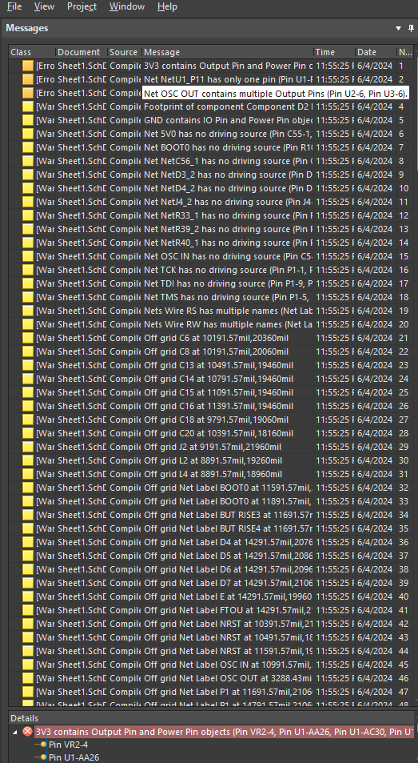
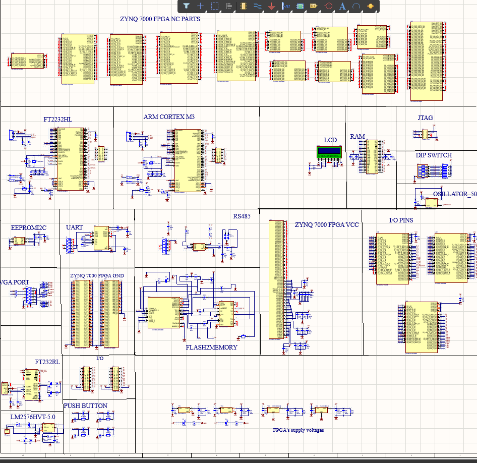
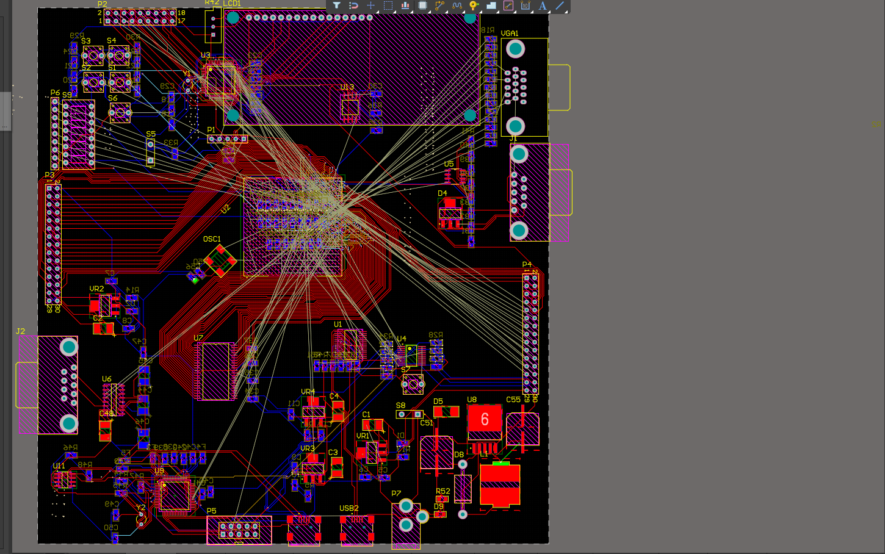
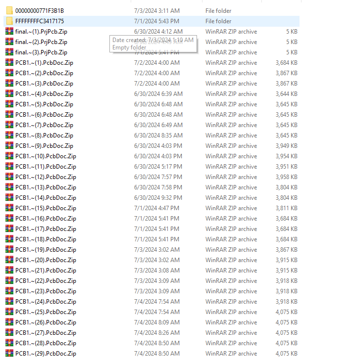

# Xilinx Zynq-7000 SoC Development Board: Multi-Layer Hardware PCB Design

[](https://www.altium.com/)
[](#pcb-stackup--manufacturing-specifications)
[-red.svg)](#system-architecture--subsystems)
[](#usb-jtag--uart-interface)
[](LICENSE)

A complete, production-grade printed circuit board (PCB) hardware design for a **Xilinx Zynq-7000 All Programmable SoC** development motherboard designed in **Altium Designer**. The board features fine-pitch BGA dog-bone escape routing, a high-speed parallel SRAM memory bus, an integrated FTDI FT2232 USB-to-JTAG/UART programmer, and an optimized multi-rail Power Distribution Network (PDN).

---

## Table of Contents
- [Design Highlights](#design-highlights)
- [System Architecture & Subsystems](#system-architecture--subsystems)
  - [1. Xilinx Zynq-7000 SoC Core (CLG400 BGA)](#1-xilinx-zynq-7000-soc-core-clg400-bga)
  - [2. High-Speed Asynchronous SRAM Interface](#2-high-speed-asynchronous-sram-interface)
  - [3. Integrated USB JTAG & UART Programmer](#3-integrated-usb-jtag--uart-programmer)
  - [4. Power Distribution Network (PDN) & Decoupling Matrix](#4-power-distribution-network-pdn--decoupling-matrix)
- [PCB Stackup & Manufacturing Specifications](#pcb-stackup--manufacturing-specifications)
- [Hardware Design Visual Gallery](#hardware-design-visual-gallery)
- [Repository Structure](#repository-structure)
- [Design Review & CAM Generation](#design-review--cam-generation)

---

## Design Highlights
- **Hierarchical Schematic Capture:** Clean separation between processor I/O banks, power delivery, memory buses, and communication interfaces.
- **BGA Escape Routing:** Symmetrical dog-bone via fanout designed for 0.8 mm / 1.0 mm pitch BGA ball grids.
- **Impedance & Delay Matching:** Parallel SRAM address/data bus length matching and $90\,\Omega$ differential impedance on USB lines.
- **Signal & Power Integrity:** Continuous internal ground reference plane with localized ceramic bypass capacitors ($0.1\,\mu\text{F}$ 0402) on the bottom layer directly beneath BGA power balls.

---

## System Architecture & Subsystems

```mermaid
flowchart TD
    USB["USB Type-B Port\n(5V VBUS)"] --> FTDI["FTDI FT2232HL\nDual USB Controller"]
    FTDI -->|JTAG MPSSE (TCK, TDI, TDO, TMS)| ZYNQ["Xilinx Zynq-7000 SoC\n(XC7Z010/XC7Z020 CLG400)"]
    FTDI -->|Serial UART (TXD, RXD)| ZYNQ
    
    PWR["Power Regulators\n(5V -> 3.3V, 1.8V, 1.0V)"] --> ZYNQ
    PWR --> SRAM["High-Speed SRAM\n(18 Address, 16 Data)"]
    PWR --> FTDI
    
    ZYNQ <-->|18-bit Address Bus NLA0..17| SRAM
    ZYNQ <-->|16-bit Bidirectional Data NLIO0..15| SRAM
    ZYNQ -->|Controls: NLOE, NLWE, NLUB, NLLB| SRAM
```

### 1. Xilinx Zynq-7000 SoC Core (CLG400 BGA)
- Integrates dual-core ARM Cortex-A9 MPCore with 28nm programmable logic fabric.
- Dedicated bank mapping across Banks 13, 14, 15, 16 (PL I/O) and Banks 25, 26, 27, 28, 29, 30 (PS memory and peripheral interconnects).

### 2. High-Speed Asynchronous SRAM Interface
- **Address Bus (`NLA0` – `NLA17`):** 18 lines enabling addressing up to 512K words.
- **Data Bus (`NLIO0` – `NLIO15`):** 16-bit wide bidirectional interface.
- **Byte Controls:** Upper Byte (`NLUB`) and Lower Byte (`NLLB`) enables for 8-bit or 16-bit memory access.
- **Strobes:** Fast Output Enable (`NLOE`) and Write Enable (`NLWE`).

### 3. Integrated USB JTAG & UART Programmer
- **FTDI FT2232HL:** Eliminates external hardware programmers (e.g., Platform Cable USB II).
- **Channel A:** Multi-Protocol Synchronous Serial Engine (MPSSE) hardware JTAG for direct Vivado bitstream download and software debugging.
- **Channel B:** Virtual COM port UART operating up to 12 Mbaud for serial telemetry.
- **USB Protection:** Integrated ESD suppression diodes and ferrite bead filtering on $V_{\text{BUS}}$.

### 4. Power Distribution Network (PDN) & Decoupling Matrix
- **Core Logic ($V_{\text{CCINT}} = 1.0\text{V}$):** Ultra-low impedance plane distribution supporting transient dynamic switching currents.
- **Auxiliary & High-Speed I/O ($V_{\text{CCAUX}} = 1.8\text{V}$):** Dedicated filtered copper pour.
- **General I/O ($V_{\text{CCO}} = 3.3\text{V}$):** Supplies peripheral logic, SRAM, and FTDI chips.
- **Bypass Capacitors:** Low-ESR $0.1\,\mu\text{F}$ and $0.01\,\mu\text{F}$ surface-mount ceramic capacitors connected to internal planes with low-inductance via-in-pad geometry.

---

## PCB Stackup & Manufacturing Specifications

| Parameter | Specification | Notes |
| :--- | :--- | :--- |
| **Board Layers** | **4 Layers** | Top (Signal), L2 (GND), L3 (Power), Bottom (Signal) |
| **Substrate Material** | FR-4 Standard | $T_g \ge 150^\circ\text{C}$, $\varepsilon_r \approx 4.4$ |
| **Minimum Trace Width** | **6 mil (0.152 mm)** | 15–30 mil on power nets |
| **Minimum Clearance** | **6 mil (0.152 mm)** | Track-to-track and track-to-pad |
| **Via Drill / Diameter** | **12 mil / 24 mil (0.3mm / 0.6mm)** | Standard mechanically drilled vias |
| **Surface Finish** | ENIG (Electroless Nickel Immersion Gold) | Recommended for fine-pitch BGA pads |
| **Solder Mask** | Matte Green / High Resolution | Minimum solder mask dam: 4 mil |

---

## Hardware Design Visual Gallery

| Stage | Engineering Layout View |
| :--- | :--- |
| **Schematic Overview** |  |
| **Component Placement** |  |
| **Full Board Routing** |  |
| **BGA Fanout & Routing Detail** |  |

---

## Repository Structure

```
11_Altium_PCB_Design/
├── docs/
│   ├── PCB_Design_Report.md                    # Detailed hardware architecture report
│   └── ZYNQ_Board_Schematic_Reference.pdf      # Complete schematic reference & pinout netlist
├── media/
│   ├── 01_schematic_overview.png               # Hierarchical schematic capture screenshot
│   ├── 02_component_placement.png              # Pre-route component layout & density
│   ├── 03_pcb_routing_full_board.png           # Multi-layer routed PCB top-down view
│   └── 04_pcb_routing_detail.png               # High-density BGA escape routing detail
├── pcb/
│   ├── final.PrjPcb                            # Altium PCB board project file
│   ├── final.PrjPcbStructure                   # Project hierarchy structure
│   └── PCB1.PcbDoc                             # 4-layer routed PCB document
├── schematics/
│   ├── ZYNQ.PrjPcb                             # Altium schematic project file
│   ├── ZYNQ.PrjPcbStructure                    # Project hierarchy structure
│   └── ZYNQ_Schematic.SchDoc                   # Zynq SoC schematic capture sheet
├── .gitignore
└── README.md
```

---

## Design Review & CAM Generation

1. Open the design in **Altium Designer** (version 20 or newer):
   - Open `pcb/final.PrjPcb` to inspect the routed board.
   - Open `schematics/ZYNQ.PrjPcb` to inspect the schematic diagrams.
2. Run **Design Rule Check (DRC)**:
   - Go to `Tools -> Design Rule Check...`
   - Select `Run Design Rule Check` (zero violations).
3. To view without an Altium license, upload `PCB1.PcbDoc` or `final.PrjPcb` to the free [Altium 365 Online Viewer](https://www.altium.com/viewer/).
